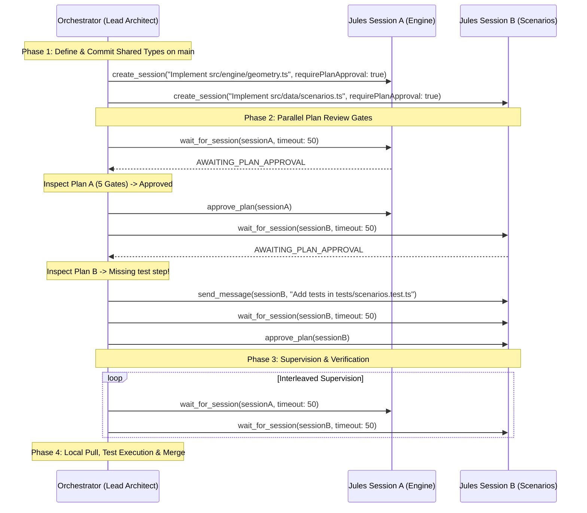

# Jules Orchestrator

A battle-tested skill for acting as a **Lead Architect and Orchestrator** delegating asynchronous coding tasks to the Google Jules agent.

As an orchestrator, you do not dump a monolithic, kitchen-sink feature onto Jules and hope for the best. Nor do you manually implement every single file yourself. Instead, you govern the architecture, decompose features into bite-sized, testable substeps, dispatch non-interfering sessions in parallel, strictly enforce plan quality, and verify pull requests before merging.

---

## The Lessons Learned: 4 Anti-Patterns to Eliminate

Past painful orchestration experiences stem from four specific failure modes:

| Anti-Pattern | What Happens | The Rule to Prevent It |
| :--- | :--- | :--- |
| **1. The Monolithic Prompt** | Prompt asks for the entire application (engine, math, scenarios, UI) in one session. Jules runs out of compute/context, generates fake stubs, inverted coordinates, and broken mock data. | **Contract-First Decomposition:** Split features into bite-sized tasks with bounded file touchsets ($< 4$ files). Commit types first. |
| **2. The Rubber-Stamp Approval** | Orchestrator blindly calls `approve_plan` on `AWAITING_PLAN_APPROVAL` without scrutinizing files, test plans, or domain invariants. | **Gatekeeper Plan Review:** Evaluate all 5 gates (Touch boundaries, test steps, anti-stubbing, coordinate/domain invariants, dependency creep). Steer via `send_message`. |
| **3. The Serial Wait Bottleneck** | Orchestrator waits 15–20 minutes sequentially for a single giant session while independent subsystems sit idle. | **Parallel Dispatch:** Identify non-interfering file domains (e.g., Engine vs Scenarios vs UI Shell) and dispatch concurrent sessions in 1 turn. |
| **4. The Unverified PR Assumption** | Orchestrator assumes a completed session equals working code. Bugs and fake mocks slip into production. | **Verification Gate:** Pull branch locally, run `npm test` / `pytest`, inspect git diff for stubs, and verify domain fidelity before merging. |

---

## Core Orchestration Principles

### 1. The Lead Architect Mindset
You are the Tech Lead; Jules is your autonomous junior/mid-level implementer.
- **You** own the architecture, type definitions, module boundaries, and acceptance criteria.
- **Jules** owns writing the implementation, edge-case logic, and unit tests within its assigned boundary.
- **Rulings, not stalls:** If an ambiguity arises during execution (e.g. naming, internal helper structure), make an authoritative decision immediately. Record the ruling in your progress notes and keep moving. Only stop to consult the user for destructive changes, auth credential changes, or severe contract breaks.

### 2. Contract-First Decomposition
Never dispatch worker sessions on a blank slate.
1. Define shared data structures, interfaces, and coordinate frames in `src/types.ts` or contracts first.
2. Commit this to the base branch (`main` or `feat/base`).
3. Now all worker agents have a frozen, unambiguous contract to implement against.

### 3. Parallel Dispatching of Non-Interfering Domains
Group tasks by domain independence:
- **Session A:** Computational core / algorithms (`src/engine/**`, `tests/engine/**`)
- **Session B:** Forensic benchmark scenarios / fixture data (`src/data/**`, `tests/scenarios/**`)
- **Session C:** UI components / dashboard shell (`src/components/**`, `tests/components/**`)

When domains do not share files, **dispatch them simultaneously**. Multiple `create_session` calls in the same turn run concurrently, slashing delivery time.

### 4. Protect the Turn Budget
Autonomous agent loops operate under a turn budget.
- **NEVER** poll in rapid loops (`get_session` every 5 seconds burns 20 steps in 1 minute).
- **ALWAYS** use `wait_for_session` with a 45–60 second `timeoutSeconds`. The server handles internal polling and returns rich milestones, consuming only 1 or 2 reasoning steps.
- When managing multiple parallel sessions, alternate `wait_for_session` between active session IDs.

---

## The Standard Orchestration Lifecycle



### Step 1: Pre-Flight & Contract Locking
Verify available sources and base branch:
```typescript
list_sources({ pageSize: 10 })
```
Ensure `src/types/` or interface contracts are committed to `main` before starting worker sessions.

### Step 2: Formulate Constrained Prompts
Every prompt to Jules must include:
1. **Objective:** Specific problem and module to implement.
2. **Context & Interfaces:** Existing types to adhere to, coordinate conventions (e.g. Canvas $+Y$ down).
3. **Boundaries & Anti-Patterns:** Exact files to touch; prohibition against touching shared configs or stubbing logic.
4. **Verification Requirement:** Specific test file to create and exact command to run (e.g., `npm test tests/geometry.test.ts`).

*(See [references/prompt-templates.md](./references/prompt-templates.md) for full templates).*

### Step 3: Dispatch (Parallel or Sequential)
For independent subsystems, dispatch concurrently:
```typescript
const sessionA = await create_session({
  source: "sources/github/owner/repo",
  startingBranch: "main",
  title: "Engine: Geometry & Wall Raycasting",
  requirePlanApproval: true,
  automationMode: "AUTO_CREATE_PR",
  prompt: `...`
});

const sessionB = await create_session({
  source: "sources/github/owner/repo",
  startingBranch: "main",
  title: "Data: Forensic Benchmark Scenarios",
  requirePlanApproval: true,
  automationMode: "AUTO_CREATE_PR",
  prompt: `...`
});
```

### Step 4: Rigorous Plan Review Gate
Wait for plan generation:
```typescript
wait_for_session({ sessionId: sessionA.id, timeoutSeconds: 50, stopOnPlanApproval: true })
```
When status is `AWAITING_PLAN_APPROVAL`, evaluate against the **5 Gates**:
1. **Touch Boundaries:** Only assigned files modified?
2. **Verification Steps:** Explicit test file and execution command included?
3. **Anti-Stubbing:** Real algorithms planned, no `// TODO` or placeholder stubs?
4. **Domain Invariants:** Correct coordinate frame, realistic physical units?
5. **Dependency Creep:** No unapproved packages?

- If **PASSED**: Call `approve_plan(sessionId)`.
- If **FAILED**: Call `send_message(sessionId, "Plan Revision Required: ...")` with precise corrective instructions.

*(See [references/plan-review-checklist.md](./references/plan-review-checklist.md) for the full rubric).*

### Step 5: Supervision & Error Recovery
- Alternate `wait_for_session` calls across active sessions with `timeoutSeconds: 45–60`.
- If a session encounters a test failure, inspect `activitiesRes` and send a targeted fix using `send_message` (maximum 3 recovery rounds).

### Step 6: Post-Execution Verification & Merge
When a session completes (`COMPLETED`):
1. **Inspect PR Output:** Review the pull request URL and diff summary.
2. **Pull Locally & Verify:**
   ```bash
   git fetch origin pull/<PR_ID>/head:pr-<PR_ID>
   git checkout pr-<PR_ID>
   npm test
   npm run build
   ```
3. **Check for Stubbed Logic:** Grep for `TODO`, `FIXME`, or unrealistic hardcoded constants.
4. **Merge in Topological Order:** Merge base engine modules first, followed by scenarios and UI components.

---

## Detailed References

- [Task Decomposition & Right-Sizing](./references/task-decomposition.md) — How to decompose complex systems into small, testable tasks.
- [Parallel Dispatching & Branch Strategy](./references/parallel-dispatch.md) — Rules for running multiple concurrent sessions without conflicts.
- [Plan Review Checklist & Gatekeeper Rubric](./references/plan-review-checklist.md) — Strict criteria for approving or rejecting plans.
- [Prompt Templates](./references/prompt-templates.md) — Ready-to-use prompt patterns for algorithms, datasets, UI, and bugfixes.
- [Advanced Orchestration Patterns](./references/patterns.md) — Autonomous recovery loops, multi-repo workflows, and background supervision.
