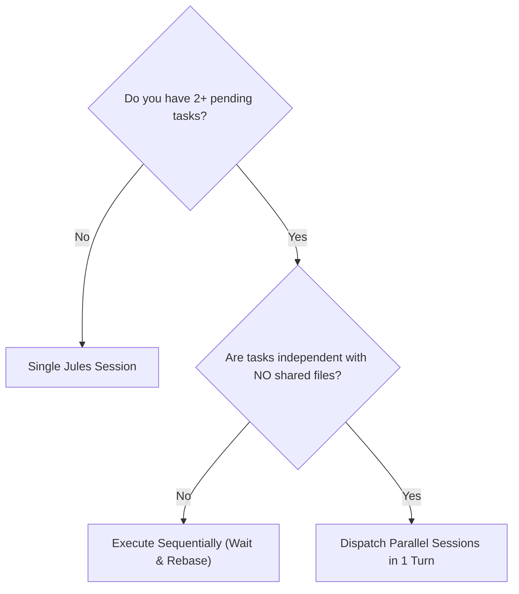
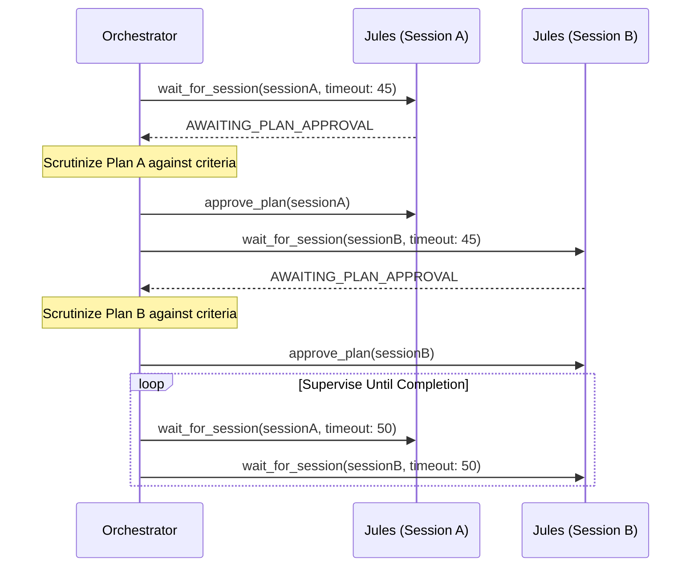

# Parallel Dispatching & Multi-Session Orchestration Guide

When tackling complex development goals, running independent tasks sequentially wastes significant orchestrator time and turn budgets. Parallel dispatching allows Jules to execute multiple non-interfering tasks concurrently.

---

## 1. When to Dispatch in Parallel



### ✅ Dispatch in Parallel When:
1. **Disjoint File Trees:**
   - Session A touches `src/engine/**`
   - Session B touches `src/data/scenarios/**`
   - Session C touches `src/components/**`
2. **Independent Bug Fixes:**
   - 3 different test files failing due to distinct, isolated root causes.
3. **Subsystem Implementations against Frozen Contracts:**
   - Once `src/types.ts` is committed to `main`, workers can implement against those interfaces simultaneously.

### ❌ Do NOT Dispatch in Parallel When:
1. **Shared State / Overlapping Files:** Both tasks need to edit the same router, main entrypoint, or shared utility file.
2. **Sequential Dependency:** Task B requires code or output produced by Task A.
3. **Exploratory Debugging:** Root cause is unknown and requires understanding full system state before choosing a direction.

---

## 2. Branch & Session Strategy

To prevent git conflicts and racing branches:

1. **Establish a Clean Base:**
   Ensure `main` (or a dedicated feature root `feat/feature-base`) has all prerequisite types and project setup committed.
2. **Set Distinct Starting Branches / PRs:**
   Use descriptive session titles and track corresponding branches:
   - Session 1: `feat/engine-geometry`
   - Session 2: `feat/scenarios-eldercare-pet`
   - Session 3: `feat/ui-timeline-controls`
3. **No Cross-Pollution:**
   Never instruct Session 2 to merge or read code from Session 1 while both are active. Both build against the shared base contract.

---

## 3. Parallel Dispatch Execution Pattern

In Antigravity or Task mode, issue multiple `create_session` calls within the same agent turn or immediate succession:

```typescript
// 1. Dispatch Session A: Computational Engine
const sessionA = await create_session({
  source: "sources/github/owner/repo",
  startingBranch: "main",
  title: "Engine: Geometry & Wall Collision Raycasting",
  requirePlanApproval: true,
  automationMode: "AUTO_CREATE_PR",
  prompt: `Implement 2D geometry algorithms in src/engine/geometry.ts...`
});

// 2. Dispatch Session B: Forensic Benchmark Scenarios
const sessionB = await create_session({
  source: "sources/github/owner/repo",
  startingBranch: "main",
  title: "Data: Forensic Ground Truth Benchmark Scenarios",
  requirePlanApproval: true,
  automationMode: "AUTO_CREATE_PR",
  prompt: `Implement realistic benchmark scenarios in src/data/scenarios/...`
});
```

---

## 4. Multi-Session Supervision Algorithm

Once multiple sessions are live, supervise them using an interleaved polling/waiting pattern without burning step budgets:



### Supervision Rules:
1. **Interleaved Waits:** Alternate `wait_for_session` calls between active sessions with `timeoutSeconds: 40-60`.
2. **Prioritize Approvals:** If a wait returns `AWAITING_PLAN_APPROVAL`, review and approve/steer immediately so the worker agent does not sit idle.
3. **Never Query Stale Sessions:** If Session A has completed, remove it from the wait loop and focus on Session B.

---

## 5. Merging & Integration Protocol

When all parallel sessions complete:

1. **Topological Pull & Verification:**
   Pull branches in order of architectural dependency:
   - Step 1: Pull and verify Core Engine PR (`feat/engine-geometry`). Run `npm test`.
   - Step 2: Pull and verify Scenarios PR (`feat/scenarios-eldercare-pet`). Run `npm test`.
   - Step 3: Pull and verify UI PR (`feat/ui-timeline-controls`). Run `npm test` & `npm run build`.
2. **Conflict Resolution:**
   Because each session had disjoint file sets, conflicts are usually limited to `index.ts` exports or package additions. Resolve these locally in the orchestrator context.
3. **Integration Verification:**
   Run the full end-to-end test suite (`npm test`) and production build (`npm run build`) before closing the orchestrator goal.
