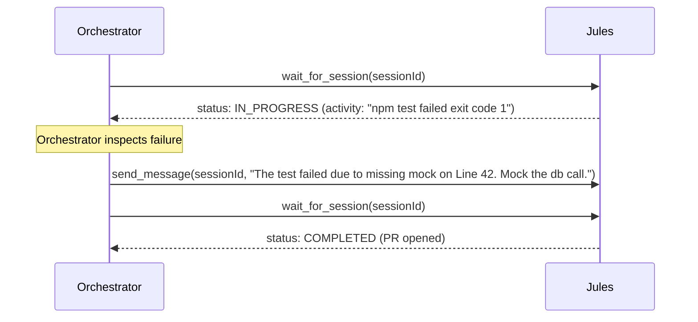
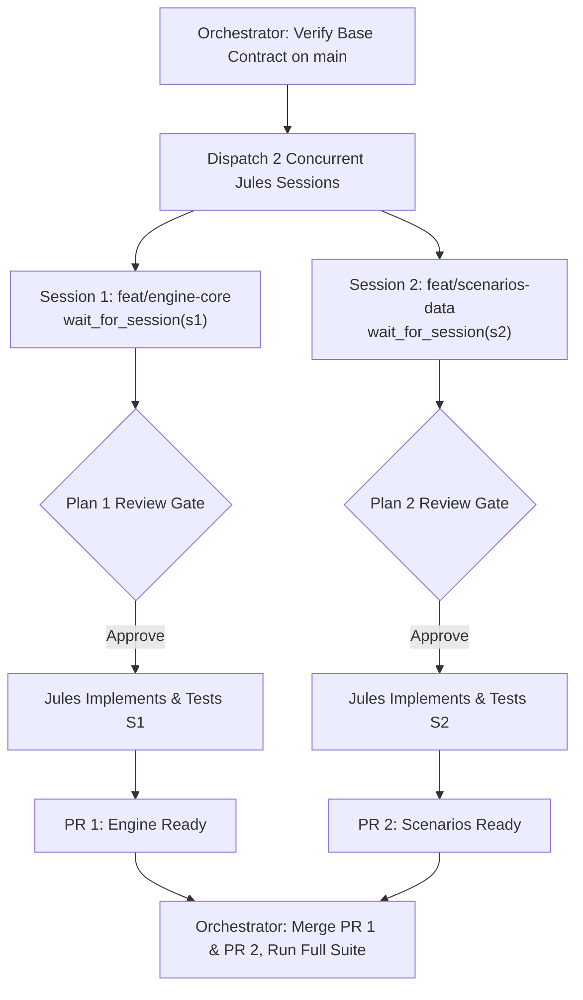

# Advanced Orchestration Patterns

This guide details advanced execution patterns for orchestrating Jules and worker agents in multi-agent workflows.

---

## Pattern 1: Autonomous Error Recovery Loop

If Jules fails a bash command or encounters a test failure during execution:

### Action Strategy:
1. Extract the bash output or error message from `activitiesRes.artifacts[].bashOutput` or latest activity description.
2. Formulate a targeted diagnostic instruction using `send_message`:
   * State the exact test or command that failed.
   * Provide the suggested fix, mock, or edge-case handling.
3. Call `wait_for_session` to allow Jules to apply the remedy.
4. **Cap Fix Rounds:** Limit recovery rounds to 3 attempts. If Jules fails to converge after 3 rounds, close the session, re-evaluate the task decomposition, or resolve the residual gap locally.

---

## Pattern 2: Multi-Session Parallel Feature Delivery

When delivering a major feature comprising independent subsystems (e.g., Domain Engine and Scenario Datasets):

### Protocol:
1. **Zero Overlap:** Guarantee that Session 1 and Session 2 do not modify overlapping files.
2. **Interleaved Polling:** Supervise both sessions by cycling `wait_for_session` calls with 45–60s timeouts.
3. **Sequential Merge Order:** Merge the computational core PR first, followed by dependent data/presentation PRs.

---

## Pattern 3: Antigravity Scheduled Background Supervisor

In Antigravity, if the orchestrator wants to perform local tasks or yield turn budget while Jules works in the background:

- Instead of keeping the foreground conversation blocked:
  1. Kick off `create_session`.
  2. Use the Antigravity `schedule` tool to set a one-shot reminder or check (e.g. 180 seconds).
  3. Let the user continue working locally on other files or discussion.
  4. When the schedule triggers, call `wait_for_session(sessionId, timeoutSeconds: 30)` and notify the user when the PR is ready.

---

## Pattern 4: Contract-First Multi-Repository Orchestration

When a feature spans multiple repositories (e.g., backend API service and frontend client):

1. **Phase 1: Backend Contract First**
   - Create session for `sources/github/owner/backend-api`.
   - Prompt: *"Implement new endpoint `POST /api/v1/auth/exchange` and export OpenAPI schema."*
   - Wait for backend PR completion and note PR branch / OpenAPI schema artifact.

2. **Phase 2: Frontend Client Integration**
   - Create session for `sources/github/owner/frontend-web`.
   - Prompt includes backend contract details: *"Integrate with backend `POST /api/v1/auth/exchange` using schema: [...]"*.
   - Wait for frontend PR completion.

3. **Phase 3: Cross-Repo Verification & Delivery**
   - Present both PR links to the user with a unified integration summary.
