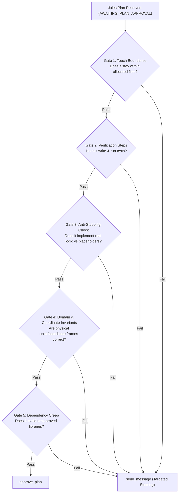

# Plan Review & Governance Checklist

The Orchestrator is the Lead Architect and Gatekeeper. When Jules pauses with `status: AWAITING_PLAN_APPROVAL`, **NEVER** rubber-stamp the plan blindly. A poor plan approved early creates broken code, hallucinated interfaces, and hours of debugging later.

---

## 1. The Gatekeeper Review Rubric

Evaluate the proposed plan (`plan.steps`) against these 5 gates:



### Gate 1: Touch Boundaries
- [ ] Does the plan only create or edit files in its assigned scope?
- [ ] Does it avoid touching global configs, core routing, or files assigned to other concurrent sessions?

### Gate 2: Verification Steps
- [ ] Does the plan explicitly include writing unit/integration test files?
- [ ] Does the plan include executing tests via bash (e.g. `npm test`, `pytest`)?
- [ ] If no test steps are present, **REJECT IMMEDIATELY**.

### Gate 3: Anti-Stubbing Check
- [ ] Does the plan describe actual algorithms, or does it say "create mock placeholder / stub"?
- [ ] Are edge cases explicitly mentioned (e.g., ray parallel to wall, boundary division by zero, dwell duration overflow)?

### Gate 4: Domain & Coordinate Invariants
- [ ] Does the plan respect domain-specific conventions?
  - E.g., Canvas $+Y$ down vs Cartesian $+Y$ up.
  - Sensor hardware coordinates vs room Point-of-Interest (POI) coordinates.
  - Conversational units and realistic speeds (e.g., human walk $0.8 - 1.8\text{ m/s}$, not $15\text{ m/s}$).

### Gate 5: Dependency Creep
- [ ] Does it plan to install unapproved npm/pip packages?
- [ ] Does it use existing project dependencies and utilities?

---

## 2. When to Steer vs. When to Approve

| Condition | Action |
| :--- | :--- |
| Plan passes all 5 gates with clear, test-backed steps | Call `approve_plan(sessionId)` |
| Plan omits test file creation or test execution | Call `send_message(sessionId, ...)` demanding test steps |
| Plan touches shared or forbidden files | Call `send_message(sessionId, ...)` restricting scope |
| Plan uses wrong coordinate system or stubbed data | Call `send_message(sessionId, ...)` supplying exact specs |
| Plan proposes unapproved external dependencies | Call `send_message(sessionId, ...)` requiring existing libraries |

---

## 3. Steering Template (`send_message`)

When steering a flawed plan, be direct, precise, and actionable:

```typescript
send_message({
  sessionId: "<sessionId>",
  prompt: `Plan Revision Required:
1. Missing Tests: Your plan does not include writing unit tests. Please add a step to write comprehensive tests in 'tests/geometry.test.ts' and execute them with 'npm test tests/geometry.test.ts'.
2. Coordinate Frame Invariant: Ensure all raycast angles account for Canvas coordinates where +Y is down (Quadrant IV is positive angle, Quadrant I is negative angle).
3. Do NOT modify 'src/types.ts'; use the existing interfaces.
Please update the plan accordingly.`
});
```

---

## 4. Rulings, Not Stalls

If an ambiguity arises that does not break architectural safety or security:
- **Decide it immediately:** Make an authoritative ruling in your steering message rather than asking the user.
- **Record the ruling:** State what was decided, why, and what it costs if wrong.
- Only stop to ask the user for destructive changes, auth credential changes, or severe contract breaks.
