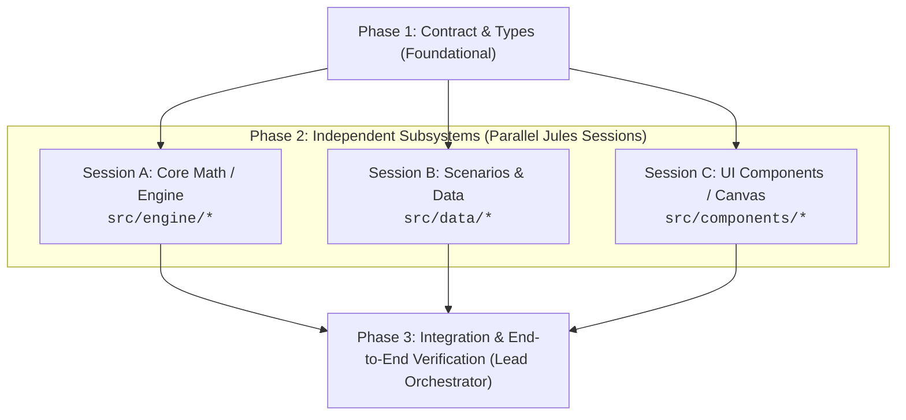

# Task Decomposition & Right-Sizing Guide

Decomposing a complex feature or system into bite-sized, verifiable tasks is the single most critical factor determining whether Jules succeeds or produces fragile, stubbed code.

---

## 1. The Core Problem: The Monolithic Fallacy

When given a prompt like:
> *"Build the entire Spatial State Reconstructor with Bayesian particle filtering, sensor degradation models, interactive floorplan UI, and test scenarios."*

An autonomous worker agent (like Jules) suffers from:
1. **Context Exhaustion:** It attempts to hold too many subsystems, types, and mathematical formulas in its context simultaneously.
2. **Quality Degradation & Fake Implementations:** To satisfy a massive specification before running out of compute/steps, it cuts corners—generating synthetic/fake mock data, placeholder math (`// TODO: integrate filter`), and stubbed tests.
3. **Hallucinated Coordinates & Contracts:** Different files end up using conflicting coordinate conventions (e.g., Canvas $+Y$ down vs. Cartesian $+Y$ up, wall mount coordinates vs. room POIs).
4. **Impossible Debugging:** If the resulting pull request fails tests, diagnosing which of the 15 generated files caused the failure is painful and wastes hours of local rework.

---

## 2. The Contract-First Decomposition Pipeline

Every multi-component feature must follow a 3-tier decomposition pipeline:

### Phase 1: Contract & Shared Types (Foundational Step)
- Define the shared data structures, interfaces, and coordinate frames first in `src/types.ts` or `src/contracts/`.
- Ensure conventions are locked down in writing (e.g., *"All coordinates are in meters, $+X$ East, $+Y$ South matching Canvas top-left origin"*).
- Commit this to the base branch (`main` or `feature/base`) *before* spawning worker sessions.

### Phase 2: Independent Subsystems (Dispatched in Parallel)
- Each session operates on a distinct file domain with **zero file overlap**:
  - **Worker A (Engine):** Writes algorithms, math, constraints, and pure unit tests.
  - **Worker B (Scenarios/Data):** Writes deterministic test cases, physical benchmark trajectories, and mock events.
  - **Worker C (Presentation):** Builds UI components against the contract types using mock data.
- Neither worker touches the other's files.

### Phase 3: Integration & End-to-End Verification
- The Orchestrator integrates the completed PRs/branches.
- Runs full integration suites and verifies end-to-end behavior.

---

## 3. Task Right-Sizing Rules

A task given to Jules must meet all 5 criteria:

| Criterion | Rule |
| :--- | :--- |
| **Single Responsibility** | Implements one subsystem, one algorithm, or one dataset. |
| **Bounded File Touchset** | Modifies or creates no more than 2–4 related files. |
| **Explicit Test Suite** | Contains an accompanying unit test file (`*.test.ts`) that verifies the exact contract. |
| **Self-Contained Context** | Does not require knowledge of ongoing work in other unmerged branches. |
| **Bounded Runtime** | Can be planned, implemented, and verified by Jules in under 10 minutes. |

---

## 4. Anti-Patterns vs. Right-Sized Tasks

### Example 1: Computational Core

- ❌ **Anti-Pattern (Too Broad):**
  > "Implement the Bayesian particle filter, spatial constraints, wall collision detection, and degradation model."
  *(Jules will generate shallow approximations and miss kinematic boundary conditions.)*

- ✅ **Right-Sized Task:**
  > "Implement `src/engine/geometry.ts` with 2D line segment intersection, wall collision detection, and sensor field-of-view ray casting. Add comprehensive tests in `tests/geometry.test.ts` covering orthogonal walls, diagonal ray intersections, and edge-aligned boundaries."

---

### Example 2: Scenario Datasets & Physical Fixtures

- ❌ **Anti-Pattern (Vague & Coupled):**
  > "Create some realistic scenarios for eldercare falls and pet movements."
  *(Jules will create 3 flat data points that don't match velocity constraints or room layouts.)*

- ✅ **Right-Sized Task:**
  > "Implement `src/data/scenarios/eldercareFall.ts` adhering strictly to `ScenarioDef` in `src/types/index.ts`. The scenario must simulate an elderly person walking at 0.6 m/s from Bedroom to Bathroom, dwelling for 45 minutes at `{x: 2.0, y: 14.5}` without camera coverage, triggering PIR motion at $T=0$ and no exit events. Verify trajectory feasibility using `validateScenario()` in `tests/scenarios.test.ts`."

---

### Example 3: UI Scaffolding

- ❌ **Anti-Pattern (Monolithic UI):**
  > "Build the complete interactive dashboard with floorplan canvas, timeline controls, sensor health inspector, and scenario runner."

- ✅ **Right-Sized Task:**
  > "Implement `src/components/TimelineControls.tsx` supporting play, pause, scrub, and speed multiplier ($0.5\times, 1\times, 5\times$). Wire it strictly to the existing state interface `PlaybackState`. Add Vitest component tests in `tests/TimelineControls.test.tsx` verifying playback ticks and scrub events."

---

## 5. Pre-Dispatch Checklist

Before creating a Jules session, verify:
- [ ] Are all types and interfaces already committed on the base branch?
- [ ] Does this task touch files that another active session is modifying? (If yes, make sequential or isolate files).
- [ ] Is there an unambiguous verification command specified (e.g. `npm test tests/geometry.test.ts`)?
- [ ] Are physical units, coordinate frames, and direction conventions explicitly stated in the prompt?
